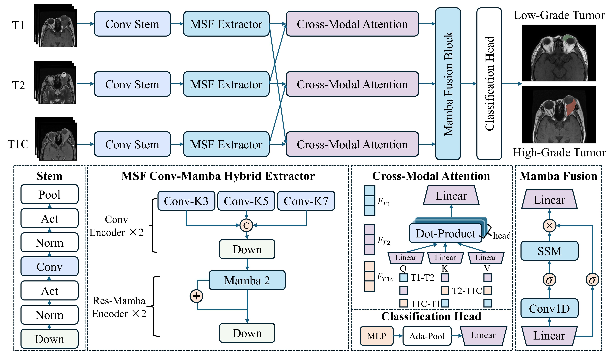
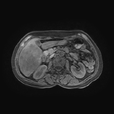
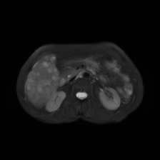
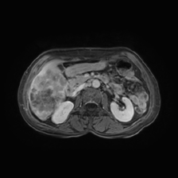
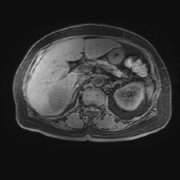
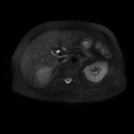
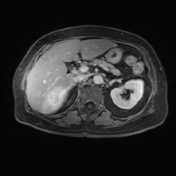

# MSHM
Code for MultiModal Hybrid Mamba Classification Model for Tumor Pathological Grade Prediction Using Magnetic Resonance Images
## Network
  

## requirements
```
conda create -n OrbitalMamba python=3.12
conda activate OrbitalMamba
# CUDA 11.8 torchaudio==2.4.1 
conda install pytorch==2.4.1 torchvision==0.19.0 pytorch-cuda=11.8 -c pytorch -c nvidia
pip install torch==2.4.0 torchvision==0.19.0 torchaudio==2.4.0 --index-url https://download.pytorch.org/whl/cu118
# 下面两个包要的时间会久一点python, 最好开梯子，去github下载对应的包
https://github.com/Dao-AILab/causal-conv1d/releases/download/v1.4.0/causal_conv1d-1.4.0+cu118torch2.4cxx11abiFALSE-cp312-cp312-linux_x86_64.whl
https://github.com/state-spaces/mamba/releases/download/v2.2.2/mamba_ssm-2.2.2+cu118torch2.4cxx11abiFALSE-cp312-cp312-linux_x86_64.whl
pip install causal_conv1d-1.4.0+cu118torch2.4cxx11abiFALSE-cp312-cp312-linux_x86_64.whl
pip install mamba_ssm-2.2.2+cu118torch2.4cxx11abiFALSE-cp312-cp312-linux_x86_64.whl

pip install monai==1.4.0 
pip install ptflops einops pillow

# gracam相关
git clone https://github.com/jacobgil/pytorch-grad-cam.git
cd pytorch-grad-cam
pip install -r requirements.txt
python setup.py install
```

## Dataset
```
Before using the dataset, please visit: https://github.com/LMMMEng/LLD-MMRI-Dataset.
```
### LLD Data Show

The high-level data in the LLD dataset are organized as follows:

- **T1 Images**:  
    
  *T1-weighted images provide detailed anatomical information.*

- **T2 Images**:  
    
  *T2-weighted images highlight different tissue contrasts and are useful for identifying certain pathologies.*

- **T1C Images**:  
    
  *T1-weighted contrast-enhanced images are crucial for visualizing tumor boundaries and other critical features.*

### LLD Data Show

The low-level data in the LLD dataset are organized as follows:

- **T1 Images**:  
    
  *T1-weighted images provide detailed anatomical information.*

- **T2 Images**:  
    
  *T2-weighted images highlight different tissue contrasts and are useful for identifying certain pathologies.*

- **T1C Images**:  
    
  *T1-weighted contrast-enhanced images are crucial for visualizing tumor boundaries and other critical features.*


## Checkpoints

Google Drive: https://drive.google.com/file/d/1TrHD9dSBLAJbKBMcK_CrSN7u6uagY0Nl/view?usp=sharing
